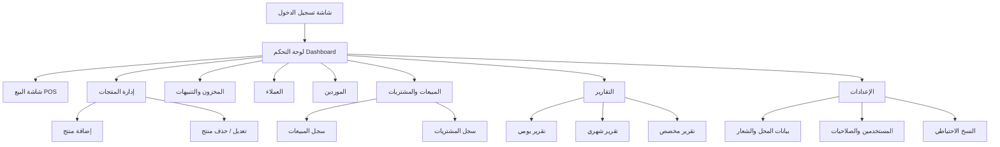

# وثيقة متطلبات المشروع (SRS)
## تطبيق إدارة نقطة بيع ومخزون
### اسم المحل: النقراشي للأدوات الصحية والسيراميك

---

## 1. نظرة عامة على المشروع

### 1.1 الفكرة
تطبيق متكامل لإدارة المحلات التجارية (أدوات صحية، سيراميك، حدايد وبويات، كهرباء، وأي نشاط تجاري مشابه) يجمع بين:
- نظام نقطة بيع (POS) سريع وسهل
- إدارة مخزون ومنتجات
- إدارة عملاء وموردين
- تقارير ومتابعة أرباح
- لوحة تحكم (Dashboard) تعرض أهم الأرقام

### 1.2 الهدف من التطبيق
تمكين صاحب المحل من إدارة نشاطه التجاري بالكامل من مكان واحد، بشكل بسيط وسريع، حتى لو لم يكن لديه خبرة سابقة في البرامج المحاسبية.

### 1.3 المنصات المطلوبة
| المنصة | مطلوب |
|---|---|
| Android | نعم |
| iOS | نعم |
| Web (متصفح) | نعم |
| Windows (Desktop) | نعم |

> ملاحظة فنية مهمة: للوصول لهذه المنصات الأربع من قاعدة كود واحدة، يُفضّل استخدام تقنية Cross-Platform (مثل Flutter أو React Native + Electron/Tauri للويندوز) بدلاً من تطوير 4 تطبيقات منفصلة، لتقليل التكلفة والوقت وضمان التزامن بين النسخ.

### 1.4 الفئة المستهدفة
أصحاب محلات الأدوات الصحية، السيراميك، الحدايد والبويات، الكهربائيات، ومحلات التجزئة المشابهة من غير المتخصصين في البرامج والمحاسبة.

---

## 2. المبادئ التصميمية العامة

- **البساطة أولاً**: كل شاشة يجب أن تُفهم خلال ثوانٍ بدون تدريب.
- **السرعة**: عمليات البيع والبحث يجب أن تتم بأقل عدد ممكن من الضغطات (Clicks/Taps).
- **العمل بدون إنترنت (Offline First)**: يجب أن يعمل التطبيق محليًا بالكامل (بيع، إضافة منتج، طباعة فاتورة) دون الحاجة لإنترنت، مع مزامنة البيانات لاحقًا عند توفر الاتصال (Sync).
- **تصميم Modern**: واجهات نظيفة، خطوط واضحة وكبيرة نسبيًا (لسهولة القراءة في بيئة المحل)، أيقونات معبّرة بدل النصوص الطويلة.
- **الهوية اللونية**:
  - 🔵 الأزرق: اللون الأساسي (الهيدر، الأزرار الرئيسية، العناصر التفاعلية).
  - 🟢 الأخضر: للدلالات الإيجابية (تم البيع بنجاح، ربح، مخزون متوفر).
  - 🔴 الأحمر: للتنبيهات والتحذيرات (نفاد مخزون، خصم/خسارة، حذف).
- دعم اللغة العربية بشكل كامل (واجهة من اليمين لليسار RTL)، مع إمكانية إضافة لغة إنجليزية لاحقًا.

---

## 3. المتطلبات الوظيفية التفصيلية

### 3.1 إدارة المنتجات
- إضافة منتج جديد يشمل: اسم المنتج، الكود/الباركود، الفئة (مواسير، خلاطات، سيراميك...)، الوحدة (قطعة، متر، كرتونة، لفة...)، سعر الشراء، سعر البيع، الكمية الحالية، الحد الأدنى للتنبيه، صورة المنتج (اختياري)، ملاحظات.
- تعديل بيانات أي منتج موجود.
- حذف منتج (مع تأكيد قبل الحذف لتفادي الحذف بالخطأ).
- تصنيف المنتجات في فئات وأقسام رئيسية وفرعية.
- دعم قراءة الباركود عبر كاميرا الموبايل أو قارئ باركود خارجي (Bluetooth/USB).
- إمكانية استيراد المنتجات دفعة واحدة من ملف Excel/CSV، وتصدير قائمة المنتجات كذلك.

### 3.2 إدارة المخزون والتنبيهات
- عرض الكمية المتاحة من كل منتج لحظيًا.
- تحديد "حد أدنى" لكل منتج، وعند وصول الكمية لهذا الحد يظهر تنبيه (باللون الأحمر) في لوحة التحكم وفي شاشة إشعارات مخصصة.
- تنبيه للمنتجات "منتهية من المخزون" (كمية = صفر) بشكل منفصل وواضح.
- سجل حركة المخزون (Stock Movement Log): كل عملية دخول أو خروج للمخزون مسجّلة بالتاريخ والسبب (بيع، شراء، تالف، جرد، تعديل يدوي).
- شاشة "جرد" (Stock Count) لمطابقة الكمية الفعلية بالمخزن مع الكمية المسجلة في النظام وتسجيل الفروقات.

### 3.3 البحث السريع
- شريط بحث دائم الظهور في شاشة المنتجات وشاشة البيع.
- البحث بالاسم، الكود، أو الباركود (سواء بالكتابة أو المسح الضوئي).
- نتائج فورية أثناء الكتابة (Live Search) بدون الحاجة لضغط زر بحث.
- ترتيب النتائج حسب الأكثر استخدامًا/مبيعًا لتسريع الوصول للمنتج المطلوب.

### 3.4 شاشة البيع (نقطة البيع - POS)
- شاشة مخصصة لعملية البيع، منفصلة عن شاشات الإدارة، لسرعة الاستخدام أثناء التعامل مع الزبون.
- إضافة منتجات للفاتورة عبر: البحث، مسح الباركود، أو الاختيار من شبكة منتجات مصنّفة بأزرار كبيرة.
- إمكانية تعديل الكمية أو السعر لكل صنف داخل الفاتورة (بصلاحية معينة).
- حساب تلقائي لـ: الإجمالي الفرعي، الخصم (قيمة أو نسبة)، الضريبة (إن وجدت)، الإجمالي النهائي.
- إدخال "المبلغ المدفوع من العميل" وحساب "الباقي (المتبقي)" تلقائيًا وفوريًا.
- دعم طرق دفع متعددة: نقدي، فودافون كاش/محافظ إلكترونية، آجل (على الحساب/دين).
- إمكانية البيع "بالدين" وربطه بحساب عميل محدد لتحصيله لاحقًا.
- طباعة فاتورة (على طابعة حرارية) أو مشاركتها كصورة/PDF عبر واتساب.
- إمكانية عمل مرتجع (Return) لفاتورة سابقة بالكامل أو جزئيًا.
- حفظ الفاتورة كـ"معلّقة" لاستكمالها لاحقًا (مفيد عند انشغال البائع بعميل آخر).

### 3.5 تسجيل المبيعات والمشتريات
- **المبيعات**: سجل كامل بكل الفواتير (رقم الفاتورة، التاريخ، الوقت، الموظف المسؤول إن وجد، العميل، المنتجات، الإجمالي، طريقة الدفع).
- **المشتريات**: تسجيل فواتير الشراء من الموردين (المنتجات، الكميات، سعر الشراء، تاريخ الاستلام)، مع تحديث المخزون تلقائيًا عند تسجيل فاتورة شراء جديدة.
- إمكانية البحث والفلترة في سجل المبيعات/المشتريات حسب التاريخ، العميل/المورد، أو المنتج.
- إمكانية إلغاء أو تعديل فاتورة (بصلاحيات محددة) مع الاحتفاظ بسجل التعديلات (Audit Log).

### 3.6 متابعة الأرباح
- حساب هامش الربح لكل منتج تلقائيًا (سعر البيع - سعر الشراء).
- عرض إجمالي الأرباح خلال فترة زمنية محددة (يومي/أسبوعي/شهري/مخصص).
- عرض المنتجات الأكثر ربحية والأقل ربحية.
- خصم المصروفات التشغيلية (إيجار، فواتير، رواتب...) من صافي الربح إن رغب صاحب المحل بتسجيلها.

### 3.7 إدارة العملاء
- سجل عملاء يشمل: الاسم، رقم الهاتف، العنوان، ملاحظات.
- كشف حساب لكل عميل يوضح: مشترياته، مدفوعاته، والرصيد المستحق عليه (الدين).
- تسجيل دفعات على الحساب (تحصيل دين) وتحديث الرصيد فورًا.
- تنبيه بالعملاء أصحاب الديون المتأخرة أو التي تجاوزت حدًا معينًا.
- إرسال تذكير للعميل عبر واتساب/رسالة نصية بقيمة المديونية (ميزة إضافية).

### 3.8 إدارة الموردين
- سجل موردين يشمل: الاسم، رقم الهاتف، العنوان، المنتجات التي يوردها.
- كشف حساب لكل مورد: فواتير الشراء منه، المدفوع له، والمتبقي له (المستحقات عليك).
- تسجيل دفعات للموردين وتحديث الرصيد.

### 3.9 التقارير
- **تقرير يومي**: إجمالي المبيعات، عدد الفواتير، الأرباح، أكثر المنتجات مبيعًا خلال اليوم.
- **تقرير شهري**: نفس التفاصيل السابقة مجمّعة شهريًا مع مقارنة بالشهر السابق (نسبة نمو أو انخفاض).
- **تقرير مخصص**: اختيار فترة زمنية بالكامل (من تاريخ - إلى تاريخ).
- **تقرير المخزون**: قيمة المخزون الحالية، المنتجات الراكدة (التي لم تُباع منذ مدة)، المنتجات منخفضة المخزون.
- **تقرير العملاء/الموردين**: إجمالي الديون المستحقة له وعليه.
- إمكانية تصدير أي تقرير كملف PDF أو Excel، أو مشاركته مباشرة عبر واتساب.

### 3.10 لوحة التحكم (Dashboard)
الشاشة الرئيسية عند فتح التطبيق، وتعرض بشكل مرئي وواضح (بطاقات وأرقام كبيرة + رسوم بيانية بسيطة):
- إجمالي مبيعات اليوم (بالأخضر).
- عدد الفواتير اليوم.
- صافي الربح التقديري لليوم.
- عدد المنتجات التي أوشكت على النفاد (بالأحمر) مع رابط سريع لعرضها.
- أعلى 5 منتجات مبيعًا هذا الأسبوع/الشهر.
- إجمالي الديون المستحقة على العملاء.
- رسم بياني بسيط لحركة المبيعات آخر 7/30 يوم.
- أزرار وصول سريع (شورت كت) لأهم الوظائف: بيع جديد، إضافة منتج، إضافة عميل.

### 3.11 إدارة المستخدمين والصلاحيات (اختياري حسب حجم المحل)
- حساب "مالك/مدير" له كل الصلاحيات.
- حساب "بائع/كاشير" صلاحياته محدودة (بيع فقط، بدون تعديل الأسعار أو حذف منتجات أو الاطلاع على الأرباح).
- سجل بكل العمليات مربوط باسم المستخدم الذي قام بها (لمعرفة من قام بأي تعديل أو حذف).

### 3.12 النسخ الاحتياطي والأمان
- نسخ احتياطي تلقائي دوري للبيانات (يوميًا) على السحابة (Cloud) بالإضافة لتخزين محلي.
- إمكانية استرجاع نسخة احتياطية سابقة عند فقدان البيانات أو تغيير الجهاز.
- حماية الدخول للتطبيق بكلمة مرور أو رمز PIN.

---

## 4. متطلبات غير وظيفية (Non-Functional Requirements)

| المتطلب | الوصف |
|---|---|
| الأداء | فتح شاشة البيع وإتمام عملية بيع كاملة يجب ألا يتجاوز بضع ثوانٍ |
| التوافقية | يعمل على أجهزة أندرويد وiOS بمواصفات متوسطة، وعلى متصفحات الويب الشائعة، وعلى ويندوز 10/11 |
| اللغة | عربي بالكامل (RTL) كلغة أساسية |
| قابلية التوسع | إمكانية إضافة فروع متعددة للمحل مستقبلًا (Multi-Branch) |
| الطباعة | دعم الطابعات الحرارية الشائعة (58مم / 80مم) عبر Bluetooth أو USB |
| التحديثات | إمكانية تحديث التطبيق دون فقدان البيانات المخزّنة |
| قاعدة البيانات | تخزين محلي (Local DB) + مزامنة سحابية (Cloud Sync) عند توفر الإنترنت |

---

## 5. تدفق الاستخدام الأساسي (User Flow) - مثال عملي

1. صاحب المحل يفتح التطبيق → يرى الـ Dashboard مباشرة.
2. يضغط "بيع جديد" → تفتح شاشة POS.
3. يبحث عن "خلاط مياه حنفية" أو يمسح الباركود.
4. يضيف المنتج للفاتورة، يحدد الكمية.
5. يضيف منتج آخر (مواسير PVC) بنفس الطريقة.
6. يضغط "إتمام البيع" → يظهر الإجمالي.
7. يدخل المبلغ المدفوع من الزبون → يظهر "الباقي" تلقائيًا.
8. يختار طريقة الدفع (نقدي) → يطبع الفاتورة أو يرسلها واتساب.
9. المخزون يتحدث تلقائيًا، والداشبورد يعكس البيع الجديد فورًا.

---

## 6. هيكل الشاشات المقترح (Sitemap)

---

## 7. مراحل تنفيذ مقترحة (Roadmap)

| المرحلة | المحتوى | الأولوية |
|---|---|---|
| المرحلة 1 (MVP) | إدارة المنتجات، المخزون الأساسي، شاشة البيع، حساب الباقي، سجل المبيعات، Dashboard مبسّط | أساسية |
| المرحلة 2 | العملاء والموردين (الديون)، المشتريات، التقارير اليومية/الشهرية | مهمة |
| المرحلة 3 | الباركود، الطباعة الحرارية، النسخ الاحتياطي السحابي، تعدد المستخدمين | متقدمة |
| المرحلة 4 | تعدد الفروع، تطبيق الويندوز والويب الكامل، تصدير Excel/PDF | توسعية |

---

## 8. بيانات المحل الأساسية (لإدراجها في إعدادات التطبيق)

- **اسم المحل**: النقراشي للأدوات الصحية والسيراميك
- **نوع النشاط**: أدوات صحية وسيراميك (قابل للتخصيص لأي نشاط مشابه: حدايد، بويات، كهرباء...)
- شعار المحل، العنوان، رقم الهاتف: تُضاف من شاشة الإعدادات وتظهر تلقائيًا في رأس كل فاتورة مطبوعة.

---

## 9. ملاحظات ختامية

- هذه الوثيقة تمثل نطاق العمل (Scope) الكامل المطلوب من التطبيق، ويمكن البدء بالمرحلة الأولى (MVP) ثم التوسع تدريجيًا حسب الأولويات في الجدول أعلاه.
- يُنصح بعمل نسخة تجريبية (Prototype/Wireframe) للشاشات الرئيسية قبل البدء في التطوير الفعلي لضمان توافق التصميم مع رؤية صاحب المحل.
